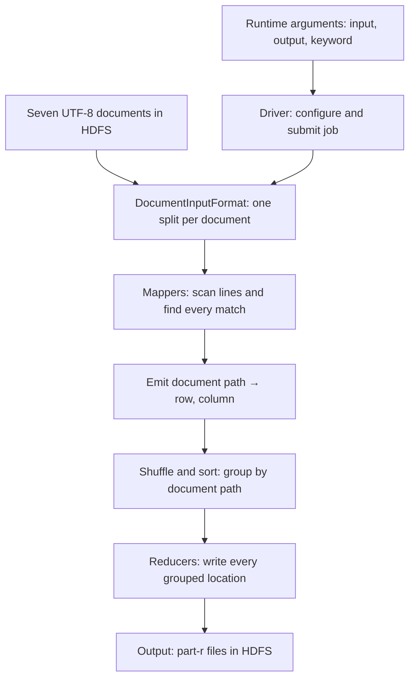

    # Question 1: MapReduce keyword search (25 marks)

## Assumptions and coordinate convention

The keyword is supplied at runtime. The demonstration uses `africa`, with case-insensitive, literal whole-word matching. `African` is not the word `africa`. Row means physical line number, including blank lines. Column means the starting Unicode character (code-point) position in that line, including spaces. Both are 1-based. A tab occupies one character position. These conventions avoid confusing character columns with word numbers or byte offsets.

## 1.1 Logical layout and explanation (7 marks)



For the demonstrated local run, the local filesystem replaces HDFS; Hadoop still executes map, shuffle and reduce tasks.

1. **Input:** Extract the supplied archive and load only the seven article `.txt` files into the input directory. Exclude macOS metadata. Each document retains a unique path.
2. **Configuration:** The driver reads input path, new output path and keyword from command-line arguments. It puts the keyword in Hadoop's job configuration so every mapper receives the same dynamic value.
3. **Input records:** The custom input format disables file splitting but streams lines through Hadoop's line reader. One mapper handles each document from its beginning. This is essential because the usual text-input key is a byte offset, not a row number; resetting a row counter on arbitrary splits would give incorrect global rows.
4. **Map:** For every physical line, increment the row counter, including blank lines. Use a case-insensitive literal pattern with whole-word boundaries. For each match calculate its 1-based character column and emit `(document_path, row<TAB>column)`. Repeated matches on one line all produce records.
5. **Shuffle/sort:** Hadoop partitions by document key and groups all locations for that document at the same reducer. Keys are sorted; values within a document are not guaranteed to be sorted.
6. **Reduce:** Iterate over the grouped locations and write each occurrence. Do not sum the values: the requested result is locations, not frequencies. A combiner is unnecessary. Documents without matches emit no records.
7. **Output:** Hadoop writes tab-separated `document_path, row, column` records to `part-r-*` files and creates `_SUCCESS` when the job succeeds. With multiple reducers, read all part files.

**Worked example:** the title in `doc1.txt` contains `Africa` at row 1, column 64. Searching for `africa` therefore emits `(doc1.txt, 1, 64)`, even though the source uses an uppercase A.

**Scalability:** Many documents can run on different data nodes. This design streams lines and reducer values, so it does not load a complete corpus into memory. Keeping a document in one split limits parallelism for a single enormous document. A production extension could first assign global line numbers or calculate prefix line counts for splits.

## 1.2 Java Mapper (9 marks)

The mapper obtains the keyword in `setup`, obtains the document path from `FileSplit`, and maintains a row counter per document. `Pattern.quote` treats the input literally rather than as executable regular-expression syntax. Unicode case-insensitive flags accept case variations without lowercasing and changing the original text positions. A `while` loop emits all occurrences. `codePointCount` converts Java's UTF-16 match offset to a character column, including supplementary characters correctly.

### KeywordMapper.java

```java
package za.ac.keyword;

import java.io.IOException;
import java.util.regex.Matcher;
import java.util.regex.Pattern;
import org.apache.hadoop.io.LongWritable;
import org.apache.hadoop.io.Text;
import org.apache.hadoop.mapreduce.Mapper;
import org.apache.hadoop.mapreduce.lib.input.FileSplit;

public class KeywordMapper extends Mapper<LongWritable, Text, Text, Text> {
    private Pattern pattern;
    private final Text document = new Text();
    private final Text position = new Text();
    private long row;

    @Override
    protected void setup(Context context) throws IOException {
        String keyword = context.getConfiguration().get("search.keyword");
        if (keyword == null || keyword.trim().isEmpty()) {
            throw new IOException("A non-empty search.keyword is required");
        }
        // Literal, Unicode-aware case-insensitive whole-word matching.
        // Letters, marks, numbers and underscore are word characters.
        pattern = Pattern.compile("(?<![\\p{L}\\p{M}\\p{N}_])"
                + Pattern.quote(keyword) + "(?![\\p{L}\\p{M}\\p{N}_])",
                Pattern.CASE_INSENSITIVE | Pattern.UNICODE_CASE);
        FileSplit split = (FileSplit) context.getInputSplit();
        document.set(split.getPath().toString()); // Full path avoids duplicate basenames.
        row = 0;
        context.getCounter("Search", "Documents").increment(1);
    }

    @Override
    protected void map(LongWritable byteOffset, Text value, Context context)
            throws IOException, InterruptedException {
        row++; // Includes empty lines; byteOffset is NOT a line number.
        String line = value.toString();
        Matcher matcher = pattern.matcher(line);
        while (matcher.find()) {
            // 1-based Unicode code-point column, not UTF-8 bytes or word index.
            int column = line.codePointCount(0, matcher.start()) + 1;
            position.set(row + "\t" + column);
            context.write(document, position);
            context.getCounter("Search", "Matches").increment(1);
        }
    }
}
```

### Supporting input format (required for correct rows)

```java
package za.ac.keyword;

import org.apache.hadoop.fs.Path;
import org.apache.hadoop.mapreduce.JobContext;
import org.apache.hadoop.mapreduce.lib.input.TextInputFormat;

/** Streams lines, but keeps each document in one split for exact row numbers. */
public class DocumentInputFormat extends TextInputFormat {
    @Override
    protected boolean isSplitable(JobContext context, Path file) {
        return false;
    }
}
```

## 1.3 Java Reducer (5 marks)

The reducer accepts one document key and an iterable of its row/column values. It writes each location under the original document key, preserving every occurrence. It streams values without accumulating them in a list, so reducer memory does not grow with the number of matches. Output records have three tab-separated fields because the value itself contains the row/column separator.

### KeywordReducer.java

```java
package za.ac.keyword;

import java.io.IOException;
import org.apache.hadoop.io.Text;
import org.apache.hadoop.mapreduce.Reducer;

/** Receives every location grouped by document; preserves all occurrences. */
public class KeywordReducer extends Reducer<Text, Text, Text, Text> {
    @Override
    protected void reduce(Text document, Iterable<Text> locations, Context context)
            throws IOException, InterruptedException {
        for (Text location : locations) {
            context.write(document, location);
        }
    }
}
```

## 1.4 Hadoop MapReduce configuration (4 marks)

The driver configures the job name and application jar; sets the custom input format, Mapper and Reducer; declares the intermediate and final key/value types; sets the output format, reducer count and paths; and waits for success. `ToolRunner` supports Hadoop generic `-D` options. The keyword is the third positional argument and is saved under `search.keyword`. At least one reducer is required by this implementation.

### KeywordSearch.java

```java
package za.ac.keyword;

import org.apache.hadoop.conf.Configured;
import org.apache.hadoop.fs.Path;
import org.apache.hadoop.io.Text;
import org.apache.hadoop.mapreduce.Job;
import org.apache.hadoop.mapreduce.lib.input.FileInputFormat;
import org.apache.hadoop.mapreduce.lib.output.FileOutputFormat;
import org.apache.hadoop.mapreduce.lib.output.TextOutputFormat;
import org.apache.hadoop.util.Tool;
import org.apache.hadoop.util.ToolRunner;

public class KeywordSearch extends Configured implements Tool {
    @Override
    public int run(String[] args) throws Exception {
        if (args.length != 3 || args[2].trim().isEmpty()
                || args[2].contains("\n") || args[2].contains("\r")) {
            System.err.println("Usage: KeywordSearch [generic -D options] <input> <new-output> <keyword>");
            return 2;
        }
        getConf().set("search.keyword", args[2]); // Runtime argument, never hardcoded.
        getConf().setBoolean("mapreduce.input.fileinputformat.input.dir.recursive", true);
        // Do not silently skip a long article line.
        getConf().setInt("mapreduce.input.linerecordreader.line.maxlength", Integer.MAX_VALUE);
        Job job = Job.getInstance(getConf(), "Case-insensitive keyword locations");
        job.setJarByClass(KeywordSearch.class);
        job.setInputFormatClass(DocumentInputFormat.class);
        job.setMapperClass(KeywordMapper.class);
        job.setReducerClass(KeywordReducer.class);
        job.setMapOutputKeyClass(Text.class);
        job.setMapOutputValueClass(Text.class);
        job.setOutputKeyClass(Text.class);
        job.setOutputValueClass(Text.class);
        job.setOutputFormatClass(TextOutputFormat.class);
        int reducers = getConf().getInt("search.reducers", 1);
        if (reducers < 1) {
            System.err.println("search.reducers must be at least 1");
            return 2;
        }
        job.setNumReduceTasks(reducers);
        FileInputFormat.addInputPath(job, new Path(args[0]));
        FileOutputFormat.setOutputPath(job, new Path(args[1]));
        // No combiner: no count or aggregation is being computed.
        return job.waitForCompletion(true) ? 0 : 1;
    }
    public static void main(String[] args) throws Exception {
        System.exit(ToolRunner.run(new KeywordSearch(), args));
    }
}
```

### Build configuration: pom.xml

```xml
<project xmlns="http://maven.apache.org/POM/4.0.0" xmlns:xsi="http://www.w3.org/2001/XMLSchema-instance" xsi:schemaLocation="http://maven.apache.org/POM/4.0.0 https://maven.apache.org/xsd/maven-4.0.0.xsd">
  <modelVersion>4.0.0</modelVersion>
  <groupId>za.ac</groupId><artifactId>keyword-search</artifactId><version>1.0.0</version>
  <properties><maven.compiler.release>8</maven.compiler.release><project.build.sourceEncoding>UTF-8</project.build.sourceEncoding><hadoop.version>3.4.2</hadoop.version></properties>
  <dependencies>
    <dependency><groupId>org.apache.hadoop</groupId><artifactId>hadoop-common</artifactId><version>${hadoop.version}</version><scope>provided</scope></dependency>
    <dependency><groupId>org.apache.hadoop</groupId><artifactId>hadoop-mapreduce-client-core</artifactId><version>${hadoop.version}</version><scope>provided</scope></dependency>
  </dependencies>
  <build><plugins>
    <plugin><groupId>org.apache.maven.plugins</groupId><artifactId>maven-compiler-plugin</artifactId><version>3.11.0</version></plugin>
    <plugin><groupId>org.apache.maven.plugins</groupId><artifactId>maven-jar-plugin</artifactId><version>3.3.0</version><configuration><archive><manifest><mainClass>za.ac.keyword.KeywordSearch</mainClass></manifest></archive></configuration></plugin>
  </plugins></build>
</project>
```

## Practical demonstration evidence

The included Java classes were compiled with Eclipse ECJ 3.33.0 targeting Java 8 and executed on OpenJDK 17 using Apache Hadoop 3.4.2's real LocalJobRunner, with its client API/runtime libraries. This is a local Hadoop execution, not a multi-node HDFS/YARN execution. The standard Maven build and cluster commands are supplied in README.md; Maven itself was not used in this environment.

The executed application command was:

```bash
java -cp 'keyword-search/target/classes:deps/*' za.ac.keyword.KeywordSearch \
  -Dmapreduce.framework.name=local -Dfs.defaultFS=file:/// \
  keyword-search/input keyword-search/evidence/run-africa africa
```

The scratch `deps` directory contained Hadoop client API/runtime 3.4.2, SLF4J API/simple 1.7.36, commons-logging 1.2 and the ECJ compiler. These third-party jars are not bundled in the submission. Use the portable `hadoop jar` commands in README.md on your Hadoop installation.

### Result summary

| Document | Matches for africa |
|---|---:|
| doc1.txt | 1 |
| doc2.txt | 3 |
| doc3.txt | 8 |
| doc4.txt | 0 |
| doc5.txt | 4 |
| doc6.txt | 0 |
| doc7.txt | 0 |
| **Total** | **16** |

### Every matching location

The following presentation is sorted by document, row and column. Raw Hadoop output retains full paths and may present locations in another order.

| Document | Row | Column |
|---|---:|---:|
| doc1.txt | 1 | 64 |
| doc2.txt | 1 | 57 |
| doc2.txt | 33 | 24 |
| doc2.txt | 58 | 81 |
| doc3.txt | 1 | 38 |
| doc3.txt | 3 | 7 |
| doc3.txt | 5 | 7 |
| doc3.txt | 40 | 146 |
| doc3.txt | 46 | 7 |
| doc3.txt | 50 | 142 |
| doc3.txt | 52 | 86 |
| doc3.txt | 54 | 44 |
| doc5.txt | 1 | 62 |
| doc5.txt | 3 | 88 |
| doc5.txt | 23 | 121 |
| doc5.txt | 38 | 27 |

### Verification

```text
PASS: 'africa': 16 occurrences; every document, row and column agrees.
doc1.txt: 1
doc2.txt: 3
doc3.txt: 8
doc5.txt: 4
PASS: 'SARS': 11 occurrences; every document, row and column agrees.
doc1.txt: 11
PASS: 'AFRICA': 7 occurrences; every document, row and column agrees.
case.txt: 7
```

- `hadoop-africa.log`: actual execution log, seven shuffled maps, 16 map-output records and 16 reduce-output records.
- `run-africa/part-r-00000` and `_SUCCESS`: actual output and successful completion marker.
- `results-africa.tsv`: readable, sorted copy of all locations.
- `hadoop-sars.log` and `run-sars/`: second keyword, proving dynamic input.
- `hadoop-edge.log`, `run-edge/`, and `tests/input/`: mixed case, multiple occurrences on a line, blank lines, CRLF, punctuation, whole-word exclusions, supplementary Unicode character and no-match document.
- `scripts/verify.py`: independent check of every document, row, column and occurrence count, including detection of duplicate or missing records.
- `compile.log`: compiler output (empty on successful warning-free compilation).

## References

Apache Hadoop 3.4.2, TextInputFormat API: https://hadoop.apache.org/docs/r3.4.2/api/org/apache/hadoop/mapreduce/lib/input/TextInputFormat.html — text records, file positions and overriding `isSplitable` to prevent splitting individual files.

Corpus: the seven article text files in the supplied `map_reduce_test_docs.zip`; assignment scenario attributed to Matanga, N.Y. (2026). Corpus text has not been changed.
